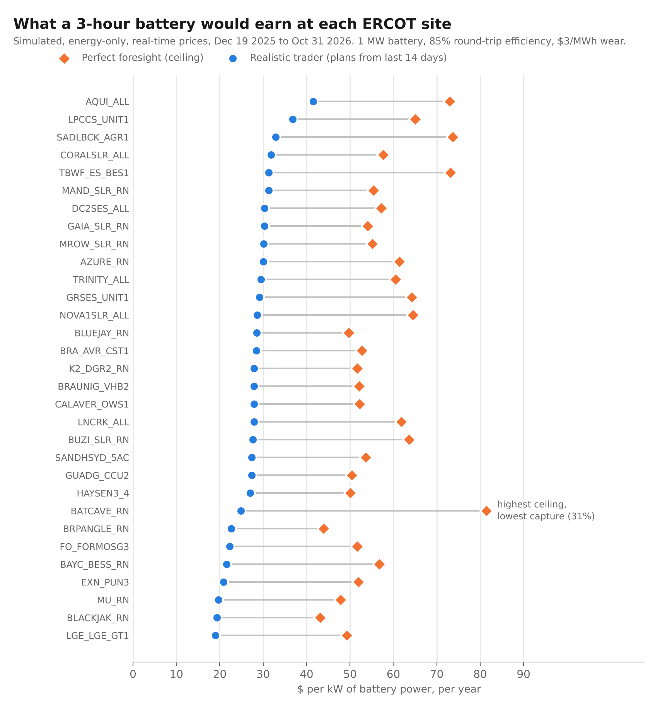
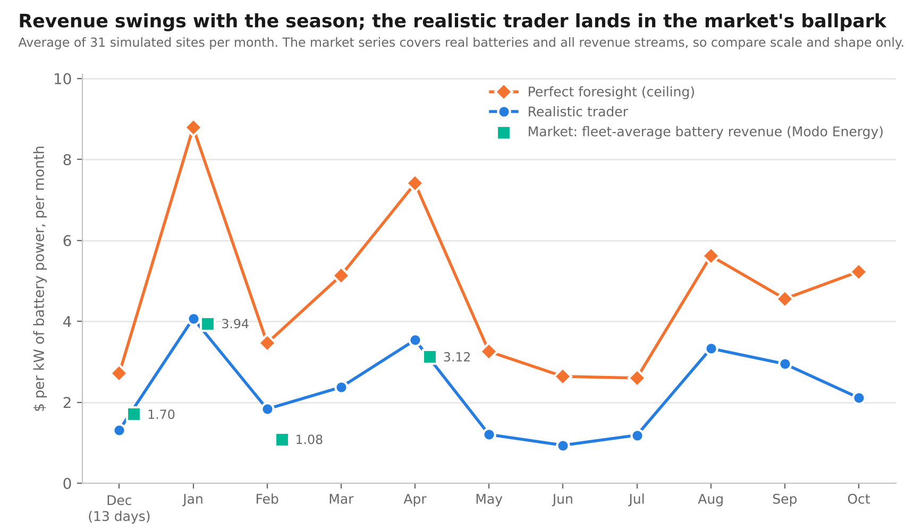

# ERCOT battery siting and dispatch backtest

What would a grid battery actually earn at different ERCOT locations, and can you pick the good
ones ahead of time? This project answers that with real ERCOT real-time prices.

It has two stages:

1. **Siting screen** (`ercot_bess_siting_rt_pipeline.py`): scores settlement points from battery-relevant
   price features (3-hour spreads, negative-price frequency, spikes, basis versus the hub) and picks a
   diversified top 3.
2. **Dispatch backtest** (`bess_dispatch.py`, `bess_backtest.py`): runs a simulated 3-hour battery on every
   node, every day, with real constraints, then tests whether a node ranking made in the past holds up on
   days it hasn't seen. This replaces the price-spread proxy with simulated battery revenue.

## Results

**Setup:** 31 physical sites (hubs and load zones are kept as benchmarks, not sites), real-time prices
from Dec 5, 2025 to Oct 31, 2026 (first trading day Dec 19, after a 14-day warm-up). A 1 MW, 3-hour
battery, 85% round-trip efficiency, $3/MWh wear. Energy arbitrage only. The window starts at ERCOT's
real-time co-optimization go-live (Dec 5, 2025) so the model never mixes the old and new market rules.



| Typical site (median of 31) | $/kW-year |
|---|---|
| Perfect foresight (an unreachable ceiling) | 55 (range 43 to 81) |
| Realistic trader (plans from the previous 14 days) | 28 (range 19 to 42) |
| Naive trader (repeats yesterday) | 17 |

- The realistic trader earns about **51% of the perfect-foresight revenue** at the median site, and beat the
  naive trader at all 31 sites.
- A high ceiling does not guarantee high earnings: BATCAVE_RN has the highest ceiling ($81) but the lowest
  capture (31%), because its value comes from spikes a past-based plan misses.



Monthly results land in the same ballpark as published fleet-average ERCOT battery revenue
([Modo Energy benchmarks](https://modoenergy.com/research/ercot-march-2026-bess-benchmark-batteries-fern-revenues)),
which is a sanity check on scale, not a like-for-like comparison: the market series covers real batteries
earning from several revenue streams, and some of its months are early estimates.

### Can you pick good sites ahead of time? Only weakly.

Nodes were ranked on days before a cut-off, then the top 3 were judged on the following days. This was repeated
in three rounds so no single season decides the answer.

| Pick on days before | Judged on | Chosen 3 ($/kW-yr) | Average site | Best in hindsight | Rank correlation, train to test |
|---|---|---|---|---|---|
| Mar 1 | next 90 days | 28.5 | 28.2 | 42.7 | 0.61 |
| Jun 1 | next 88 days | 24.1 | 22.0 | 27.7 | 0.53 |
| Sep 1 | next 61 days | 30.1 | 30.3 | 44.6 | 0.81 |

- A node's rank in training does carry over to testing (average rank correlation 0.65).
- Picking the top 3 beat the average site in 2 of 3 rounds, by **+$0.7/kW-year on average**. With three
  rounds and 31 sites that is too small to tell apart from zero, and it has not been tested for significance.
  I would not claim a selection edge from this.
- "Best in hindsight" uses the test results and is not achievable. It only shows how much room remains.

## How the simulation works

- **Dispatch** (`bess_dispatch.py`): for one day of 15-minute prices, a linear program finds the charge and
  discharge schedule with the highest profit, subject to power limit, energy capacity, round-trip losses,
  a wear cost per MWh discharged, and ending the day at least as full as it started. If a day's solution would
  charge and discharge in the same interval (which negative prices can tempt a plain LP into), the day is
  re-solved with a binary constraint so the result is physically achievable.
- **Policies** (`bess_backtest.py`): perfect foresight optimizes on the day's actual prices. The realistic trader
  optimizes on the median price shape of the previous 14 days, then the schedule is paid at actual prices. The
  naive trader uses yesterday's prices. No policy sees the day it trades; a test checks this.
- **Walk-forward test:** rank on the past, judge on the future, repeated in rounds. Ranking score is realized
  revenue minus a downside penalty, and the chosen group is penalized when members' daily revenues move together.

## Limitations

- **Energy-only, real-time prices.** No day-ahead market, ancillary services, fees or imbalance costs, so these
  are an energy-only floor, not total battery revenue.
- **A simple forecast.** The realistic trader is a baseline. A desk with day-ahead information and a better
  forecast would capture more than 51%.
- **Small sample.** One market regime (post go-live), 31 sites, three test rounds.
- **Seasonality.** Value ranges from about $100/kW-year equivalent in January to about $30 in June to July
  (perfect foresight), so a single train/test split is fragile.
- Hubs and load zones are excluded from site choice, and two nodes with identical prices are counted once.

## Reproduce it

You need an [ERCOT Public API](https://developer.ercot.com/applications/pubapi/user-guide/registration-and-authentication)
account (free).

```bash
python3 -m venv .venv && source .venv/bin/activate
pip install -r requirements.txt
cp .env.example .env            # then fill in your ERCOT username, password and subscription key

# 1. Download 12 months of 15-minute prices (about 20 to 25 minutes, resumable)
python pull_rt_spp.py --start 2025-11-01 --end 2026-10-31 \
    --settlement-points-file settlement_points_40.txt --hub HB_NORTH
python pull_rt_spp.py --combine                 # writes data/rt_spp_all.csv.gz

# 2. Run the backtest (about 2 to 3 minutes)
python bess_backtest.py --from 2025-12-05 --to 2026-10-31 \
    --splits 2026-03-01,2026-06-01,2026-09-01

# Try the code without any data
python bess_backtest.py --synthetic

# Tests and charts
python -m pytest -q
python tools/make_charts.py
```

Your `.env` is ignored by git. The saved results behind the charts are in `results/`.

## Files

| File | What it does |
|---|---|
| `pull_rt_spp.py` | Resumable downloader for ERCOT real-time prices, one file per node per month |
| `bess_dispatch.py` | Battery model and one-day optimizer |
| `bess_backtest.py` | Policies, daily backtest, node ranking, walk-forward test |
| `ercot_bess_siting_rt_pipeline.py` | The original siting screen and the ERCOT API client |
| `synthetic_prices.py` | Fake prices for testing the code (not a result about ERCOT) |
| `tests/` | 19 tests, including hand-worked battery cases and a no-lookahead check |
| `tools/` | Chart script and settlement-point list builder |
| `results/` | Saved backtest outputs |
| `docs/` | Charts |

## Data and disclaimer

Prices come from ERCOT's public reports API (NP6-905, real-time settlement point prices). This is a research
project, not investment advice.

## License

See `LICENSE`.
